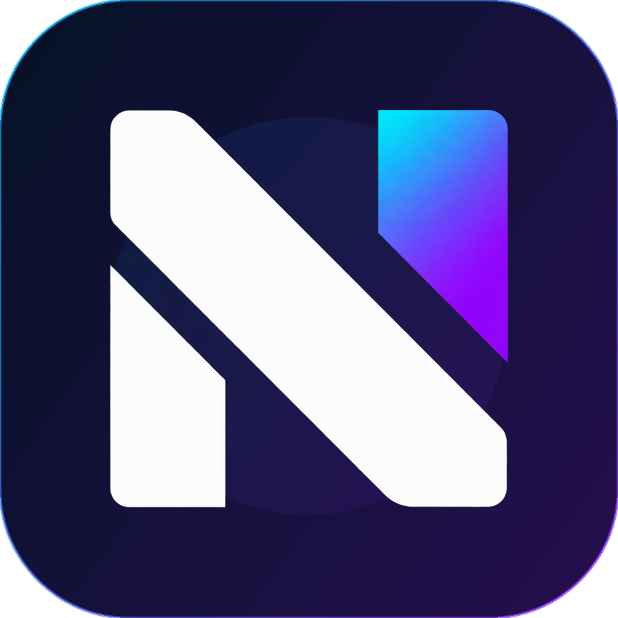
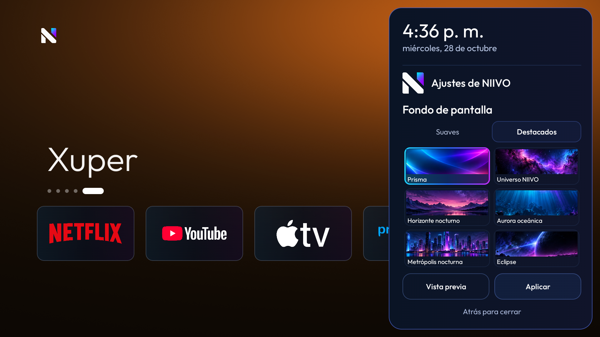
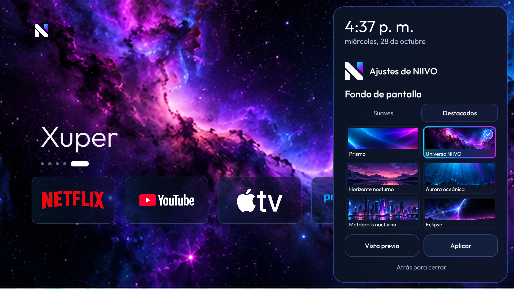

# NIIVO Launcher

  

<strong>NIIVO Launcher</strong> <em>Tu Fire TV, a tu manera.</em>

NIIVO es una pantalla de inicio para Fire TV, controlada con el mando y personalizable con tus aplicaciones y fondos favoritos. La versión **2.1.0 estable** incluye NIIVO Launcher para Fire TV y NIIVO Installer para Android.

## Descargar e instalar

La forma recomendada de instalar o actualizar NIIVO es con **NIIVO Installer en un teléfono Android**. El instalador ya incluye el Launcher y se conecta al Fire TV por ADB; normalmente no necesitas bajar el APK del Launcher por separado.

<a href="https://github.com/isaacguzmanr/NIIVO-Fire-TV-Installer/releases/download/v2.1.0/NIIVO-Installer-v2.1.0.apk"><strong>Descargar NIIVO Installer 2.1.0 para Android</strong></a>

En la [release estable 2.1.0](https://github.com/isaacguzmanr/NIIVO-Fire-TV-Installer/releases/tag/v2.1.0) también están el APK de NIIVO Launcher y el archivo `SHA256SUMS.txt` para verificar las descargas. Para la instalación habitual, empieza por el Installer.

### Requisitos para instalar en Fire TV

1. Activa **Depuración ADB** en las opciones para desarrolladores del Fire TV.
2. Conecta el teléfono y el Fire TV a la misma red Wi-Fi.
3. Abre NIIVO Installer, elige **Instalar** o **Actualizar** y busca el televisor. Si no aparece, introduce la IP que muestra Fire TV en la configuración de red.
4. Acepta en la pantalla del televisor el aviso de autorización ADB.

Fire OS puede pedir que actives manualmente el servicio de accesibilidad de NIIVO para interceptar el botón Inicio. Si el sistema lo desactiva después, NIIVO Installer incluye **Reparar accesibilidad**. La reparación usa ADB y requiere que el televisor esté en la misma red y autorizado.

## Vista previa de NIIVO

Capturas reales de la interfaz de NIIVO en ejecución. No son conceptos ni imágenes generadas. Las capturas disponibles aquí muestran el selector de fondos y su estado de selección; no tenemos capturas verificadas para todos los submenús de esta versión.

### Selector de fondos

### Vista previa y fondo seleccionado

## Novedades de la versión 2.1.0

- Menú contextual del dock y desplazamiento más claro en la lista de aplicaciones ocultas.
- Nuevos fondos y mejoras visuales del launcher, sus tarjetas y el indicador de selección.
- Detección y selección de Fire TV desde NIIVO Installer, con entrada manual de IP disponible.
- Reparación del servicio de accesibilidad desde NIIVO Installer.
- Mejoras en la comprobación y la instalación de actualizaciones del Launcher.

Las funciones disponibles dependen de Fire OS, del modelo y de los permisos que autorice el usuario. Consulta el [changelog](CHANGELOG.md) para las notas de esta versión y el historial.

## Actualizaciones

En NIIVO Installer, abre **Actualizar** para consultar la release del Launcher en GitHub. El instalador compara la versión instalada con la publicada y descarga el APK correspondiente. Las betas se distribuyen como pre-releases; la descarga enlazada arriba es la estable 2.1.0.

Una actualización puede instalarse encima de la versión anterior cuando coincide el identificador del paquete y la firma. No desinstales la app antes de actualizar, porque Android podría borrar sus datos.

## Compatibilidad

- **NIIVO Installer:** Android 8.0 (API 26) o posterior.
- **NIIVO Launcher:** Fire TV con Fire OS compatible con Android 11 (API 30) o posterior.
- La instalación requiere ADB habilitado, el teléfono y el televisor en la misma red y autorización en el televisor.

Estas son las versiones mínimas declaradas por las aplicaciones, no una certificación de todos los modelos Fire TV. La detección de dispositivos también depende de la red local y de la configuración de ADB.

## Proyecto y soporte

- **Versión actual:** 2.1.0 estable.
- **Release y descargas:** [NIIVO 2.1.0](https://github.com/isaacguzmanr/NIIVO-Fire-TV-Installer/releases/tag/v2.1.0).
- **Ayuda y errores:** [GitHub Issues](https://github.com/isaacguzmanr/NIIVO-Fire-TV-Installer/issues).
- **Sitio:** [niivo.app](https://niivo.app).
- **Licencia:** no se declara una licencia propia; el repositorio no contiene un archivo `LICENSE`.

Consulta `app/src/main/assets/THIRD_PARTY_NOTICES.txt` para los avisos de componentes de terceros incluidos en NIIVO Installer.
