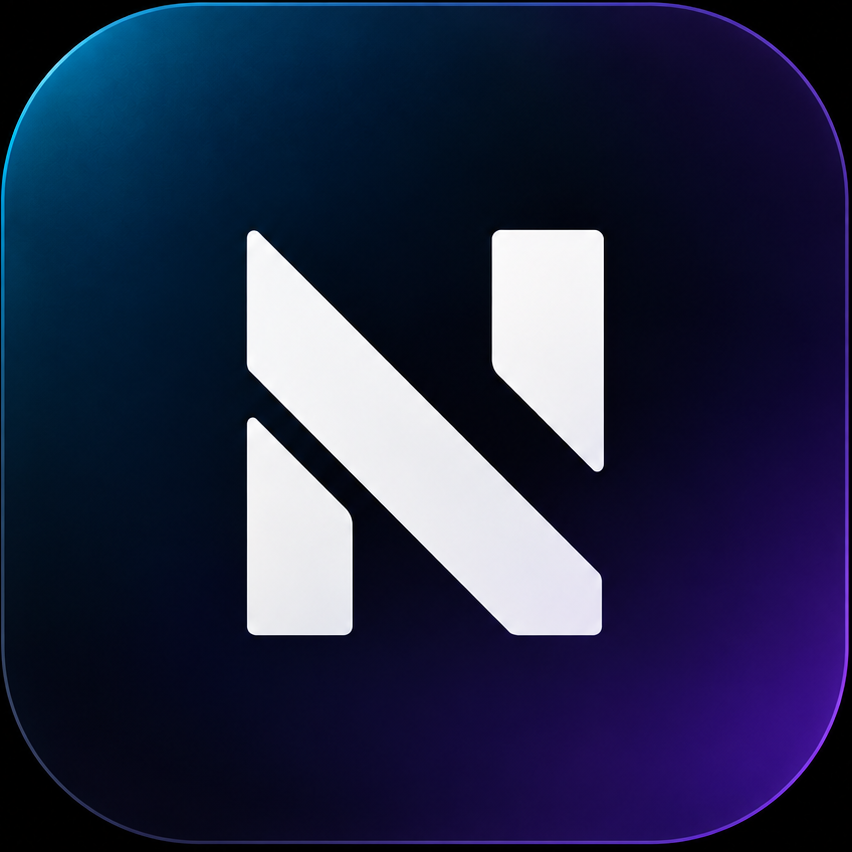
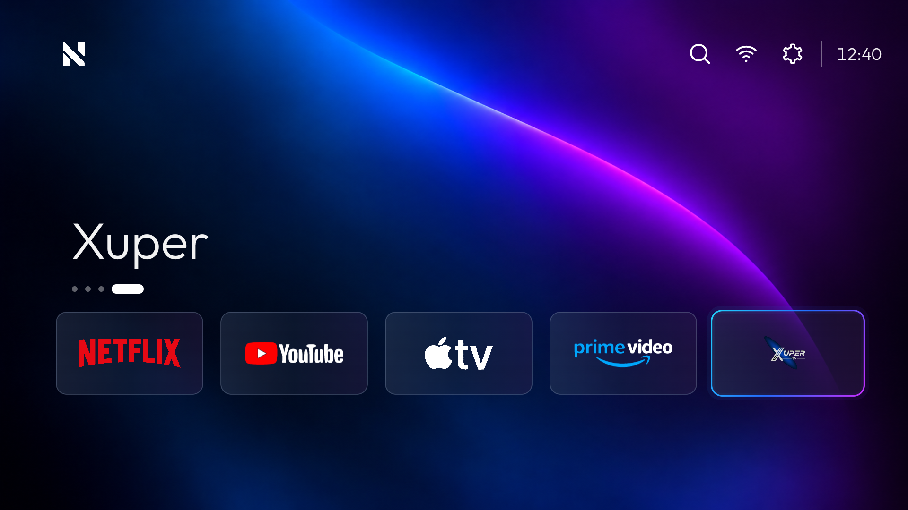
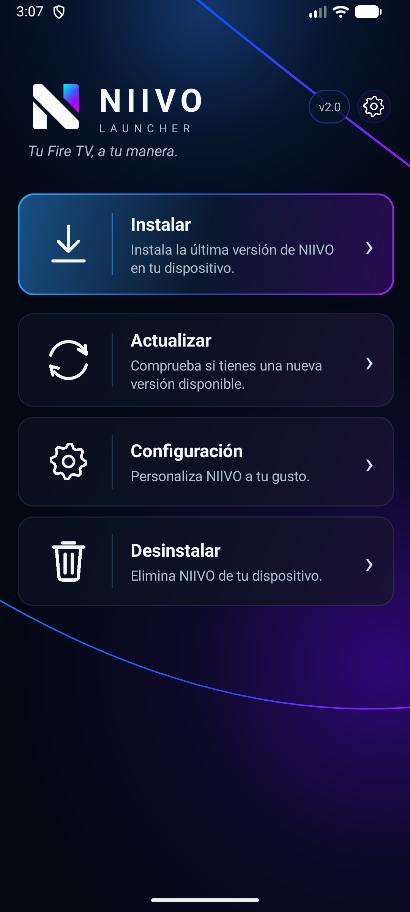
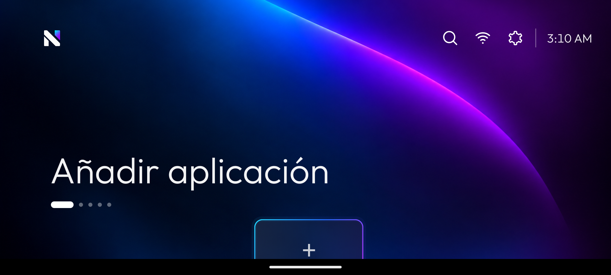
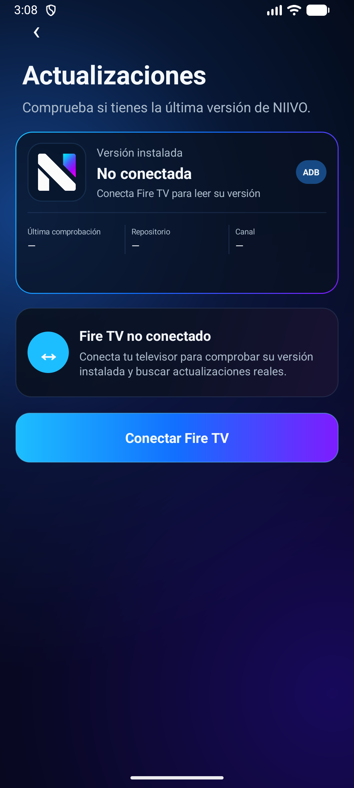
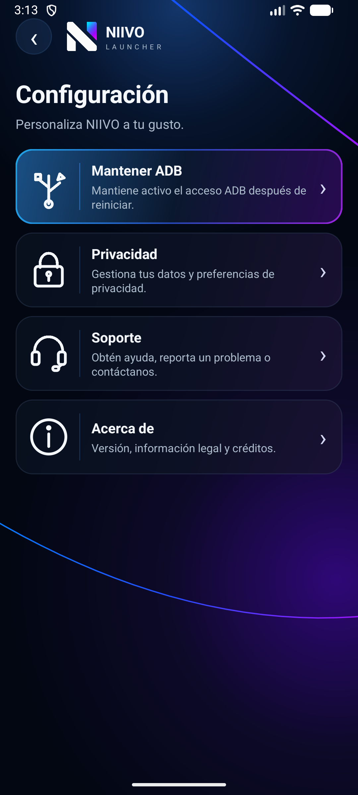

# NIIVO Launcher para Fire TV

<p align="center">
  
</p>

<p align="center"><strong>NIIVO Launcher</strong><br><em>Tu Fire TV, a tu manera.</em></p>

NIIVO reemplaza la pantalla de inicio de Fire TV por un launcher sencillo que permite abrir aplicaciones favoritas con el control remoto. Para instalarlo, utiliza **NIIVO Installer** en tu teléfono: ya incluye el APK del Launcher y lo envía al Fire TV mediante ADB. No necesitas descargar el APK del Launcher por separado.

> **NIIVO 2.0 estable.** Para instalar el Launcher en Fire TV, descarga NIIVO Installer para Android: incluye el Launcher y lo instala mediante ADB.

<p align="center"><a href="https://github.com/isaacguzmanr/NIIVO-Fire-TV-Installer/releases/download/v2.0/NIIVO-Installer-v2.0.apk"><strong>Descargar NIIVO Installer para Android</strong></a><br>Versión estable 2.0. NIIVO Launcher se instala desde el Installer.</p>

## Vista previa de NIIVO

Las imágenes son capturas del software ejecutándose, no conceptos generados. La captura del Launcher con cinco aplicaciones corresponde a una sesión funcional anterior; la captura del estado vacío es del APK 2.0 instalado en un emulador sin aplicaciones de TV. Las capturas del Installer se tomaron en el emulador Android API 37 durante esta preparación.

| NIIVO Launcher | NIIVO Installer |
| --- | --- |
|  |  |
|  |  |



La pantalla de actualizaciones de la captura muestra honestamente el estado **Fire TV no conectado**. No se dispone aquí de capturas nuevas de la instalación ADB completada ni del menú contextual del Launcher.

## Versiones

| Aplicación | Versión | versionCode | applicationId |
| --- | ---: | ---: | --- |
| NIIVO Launcher | `2.0` | `10` | `com.ivantrj.glasslauncher` |
| NIIVO Installer estable | `2.0` | `17` | `com.nivo.installer` |
| NIIVO Installer beta actual | `2.1.0-beta.4` | `19` | `com.nivo.installer` |

La beta del Installer es una pre-release para pruebas. La versión estable recomendada sigue siendo 2.0; [descarga la beta 2.1.0-beta.4](https://github.com/isaacguzmanr/NIIVO-Fire-TV-Installer/releases/tag/v2.1.0-beta.4) si quieres probar la reparación de accesibilidad.

Los valores de versión se definen en los respectivos `app/build.gradle`. El Installer lee la versión incluida del Launcher desde los metadatos reales del APK.

## Funciones implementadas

### Launcher

- Muestra las aplicaciones instaladas que exponen una actividad de inicio para TV.
- Permite mantener hasta cinco favoritas y navegarlas con el D-pad.
- Incluye controles de búsqueda, Wi-Fi y ajustes en la barra superior.
- El menú contextual del dock ofrece acciones sobre la aplicación enfocada.
- El servicio de accesibilidad redirige el botón Inicio a NIIVO y devuelve el foco al launcher al salir de Ajustes de Fire TV.

### Installer para Android

- Busca dispositivos ADB en la red local y permite introducir una IP manualmente.
- Instala y desinstala el APK incluido mediante ADB, después de que el usuario autorice la conexión en el televisor.
- Comprueba releases públicos de GitHub para el Launcher, valida el nombre y la versión del APK y comprueba el SHA-256 cuando el release lo publica.
- Separa los canales según la versión instalada: una instalación estable consulta releases estables y una versión beta permite consultar versiones beta y estables.
- Intenta habilitar y verificar por ADB el servicio de accesibilidad de NIIVO tras instalar o actualizar el Launcher; si el dispositivo no lo confirma, presenta una advertencia y ofrece la reparación manual desde Configuración.
- Permite reparar accesibilidad desde Configuración, reusando la IP guardada o solicitando otra y validando que NIIVO esté instalado en un Fire TV antes de cambiar el servicio.
- Incluye pantallas de configuración, ADB, privacidad, soporte y acerca de.

La presencia de una función en esta lista confirma que existe en el código. No significa que se haya validado en todos los modelos de Fire TV.

## Instalación

### NIIVO Installer en Android

El Installer declara `minSdk 26` (Android 8.0). Para instalarlo:

1. Descarga [**NIIVO Installer para Android (versión 2.0)**](https://github.com/isaacguzmanr/NIIVO-Fire-TV-Installer/releases/download/v2.0/NIIVO-Installer-v2.0.apk). Ese es el APK que debes instalar en el teléfono; no descargues NIIVO Launcher por separado.
2. En Android, permite instalar aplicaciones desde la fuente que descargó el APK y confirma la instalación.
3. En Fire TV, activa **Depuración ADB** en las opciones para desarrolladores.
4. Conecta el teléfono y el Fire TV a la misma red Wi-Fi.
5. En NIIVO Installer, elige **Instalar** o **Actualizar**, busca el Fire TV o escribe su IP y acepta el aviso de depuración en el televisor.

El Installer no puede aceptar la autorización ADB en nombre del usuario. La disponibilidad de opciones y el nombre de los menús de desarrollador dependen de la versión de Fire OS.

### NIIVO Launcher en Fire TV

El Launcher declara `minSdk 30` (Android 11). El proceso de instalación requiere ADB y la autorización del usuario. Para redirigir el botón Inicio, Fire OS también requiere que el usuario active el servicio de accesibilidad de NIIVO; Android no permite que la aplicación lo habilite silenciosamente.

## Actualizaciones

NIIVO Installer comprueba si hay una versión nueva del Launcher en GitHub y permite instalarla desde el teléfono. La versión instalada se obtiene del Fire TV; la app compara esa versión con la publicación y valida el APK antes de enviarlo por ADB. Para mantener NIIVO al día, abre **Actualizar** dentro de NIIVO Installer. No hace falta bajar ni instalar manualmente el APK del Launcher.

## Compatibilidad verificada

- **Installer:** `minSdk 26`; se instaló y abrió en un emulador Android genérico API 37 con resolución 1080 × 2400.
- **Launcher:** `minSdk 30`; el APK release se instaló y abrió en el mismo emulador API 37. El emulador no tenía aplicaciones de Android TV instaladas.
- **Fire TV físico y Samsung Galaxy S21 FE 5G:** no conectados ni verificados en esta preparación. La compatibilidad con todos los modelos y versiones de Fire OS no está certificada.

## Construir desde el código

Desde la raíz del proyecto Installer, en Windows:

```powershell
.\gradlew.bat clean assembleDebug
```

El APK de depuración queda en `app/build/outputs/apk/debug/app-debug.apk`. El APK release local del Installer queda en `releases/NIIVO-Installer-v2.0.apk`. Para instalar NIIVO desde un teléfono, usa el Installer; no necesitas buscar ni descargar el Launcher por separado.

Para mantener la posibilidad de actualizar el Installer ya publicado, este candidato se firma con el certificado local existente que coincide con el certificado del Installer público anterior. En esta computadora Android Gradle lo referencia mediante `signingConfigs.debug`; no es una clave privada nueva ni se guarda la keystore en Git. Conserva y respalda el archivo de firma local: una instalación futura solo podrá actualizar esta app si conserva el mismo certificado.

El código fuente del Launcher está en el proyecto Android separado. Para una compilación de prueba, ejecuta desde su raíz:

```powershell
.\gradlew.bat clean assembleDebug
```

## Proyecto, soporte y licencia

- **Versión:** 2.0 estable.
- **Repositorio y soporte:** [GitHub](https://github.com/isaacguzmanr/NIIVO-Fire-TV-Installer).
- **Reportar un problema:** [GitHub Issues](https://github.com/isaacguzmanr/NIIVO-Fire-TV-Installer/issues).
- **Sitio enlazado desde la aplicación:** [niivo.app](https://niivo.app).
- **Licencia propia del proyecto:** no se encontró un archivo `LICENSE`; no se declara una licencia del proyecto.
- **Aviso de terceros:** `com.tananaev:adblib:1.3` está bajo BSD 3-Clause; el texto está en `app/src/main/assets/THIRD_PARTY_NOTICES.txt`.

Para compilar, usa Android Gradle Plugin y Java 17 según los archivos Gradle del proyecto. Para repetir un release actualizable se requiere conservar la misma keystore local y no reemplazar su certificado.
